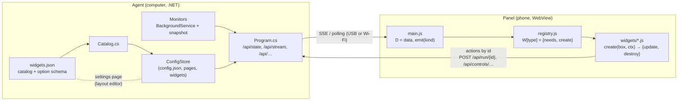
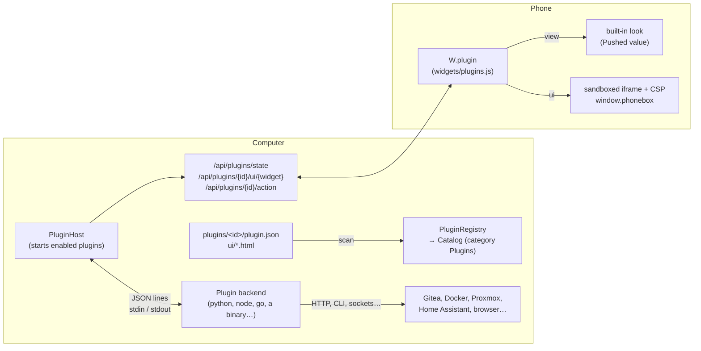

# Community plugins

*Português: [PLUGINS.pt-BR.md](PLUGINS.pt-BR.md)*

Plugins add widgets and integrations to PhoneBox without forking or rebuilding the agent: a Gitea or Proxmox monitor,
Home Assistant dashboards, container controls, a bridge to a browser extension. A plugin is a folder with a manifest
(`plugin.json`), an optional **backend** (any program that reads and writes JSON lines) and its widgets' **UI**.

This page explains how the built-in widgets work, how plugins fit into that design, and how to write one.
A complete working example is in [`extras/plugins/http-status`](../extras/plugins/http-status).

- [How the built-in widgets work](#how-the-built-in-widgets-work)
- [How plugins fit in](#how-plugins-fit-in)
- [Installing and managing plugins](#installing-and-managing-plugins)
- [Writing a plugin](#writing-a-plugin)
- [Manifest reference](#manifest-reference)
- [Backend protocol](#backend-protocol)
- [Widget UI](#widget-ui)
- [Security model](#security-model)
- [Limits](#limits)
- [Roadmap](#roadmap)

## How the built-in widgets work

A built-in widget is spread over four places in two programs: the **agent** on the computer (.NET) and the **panel**
on the phone (HTML/JS in an Android WebView).



1. **Catalog** (`agent/PhoneBox.Agent/widgets.json`): each widget type has a name, icon, category, size and an
   `options` schema (`text`, `number`, `bool`, `select`, `lines`, …). The settings page builds the widget list and the
   option inspector from it (`GET /api/catalog`). `Catalog.cs` reads it, and `ConfigStore` drops any widget whose type
   is not in it when settings are loaded or saved.
2. **Data on the computer**: a *monitor* (`DockerMonitor`, `GitHubMonitor`, `SystemMonitor`…) is a `BackgroundService`
   registered with `AddMonitor<T>()` in `Program.cs`. It polls something on a timer (often only while a phone is
   looking) and keeps the latest result in a `volatile` snapshot that the HTTP API returns.
3. **Transport**: the phone holds one server-sent-events stream (`GET /api/stream`) with `state` every second,
   `event` as soon as one happens and `work` when it changes; without it the panel polls `/api/state`. Heavier data has
   its own endpoint (`/api/docker`, `/api/calendar`, …) loaded when a version number in `state` changes or on a timer.
   Over USB this goes through `adb reverse`; over Wi-Fi through HTTPS with a pinned certificate and a token.
4. **Panel**: widgets register in a shared registry, `W[type] = { needs, bare?, create(box, ctx) }`.
   `create` builds the DOM in `box` and returns `{ update(kind), destroy() }`. `needs` lists the data kinds that
   trigger `update` (`state`, `push`, `work`, `tick`, …). `main.js` keeps all data in the global `D` and calls
   `emit(kind)`, which updates the widgets on the visible pages and marks the others dirty.
5. **Actions** never carry commands: the phone sends an **id** (`POST /api/run/{shortcut}`,
   `/api/widget/{page}/{widget}`, `/api/controls/command/{kind}`), and the agent looks up what to do in its own
   config. Dangerous actions also need an opt-in option on the widget (`control`, `allowKill`).

Adding a widget to PhoneBox itself therefore means editing `widgets.json`, writing a monitor and a route in C#,
writing a `W[type]` in `widgets/*.js`, importing it in `main.js`, and shipping a new agent and APK.

Two generic escape hatches already existed, and plugins build on both:

- **Webhooks** (`POST /api/push/{key}`, `PushStore`): anything can push a value; the *Pushed value* widget shows it.
  One-way only, no per-widget options, no actions.
- **Custom HTML** widget (`widgets/pc.js`): your own HTML/JS in a sandboxed iframe that receives the panel's data by
  `postMessage`. No backend, and the only actions are existing shortcuts.

## How plugins fit in



| Built-in piece | Plugin equivalent |
|---|---|
| Entry in `widgets.json` | `widgets[]` in `plugin.json`, same option schema; listed under **Plugins** in the widget list |
| Monitor (`BackgroundService` + snapshot) | The plugin's **backend**: a separate process the agent starts, restarts and stops |
| Data endpoint + version in `/api/state` | The backend sends `{"type":"state","key":…,"data":…}`; the panel reloads `/api/plugins/state` when `pluginsVersion` changes |
| `W[type]` in `widgets/*.js` | `"view"` (a built-in look, no code on the phone) or `"ui"` (the plugin's HTML in a sandboxed iframe) |
| Actions by id | `"actions": ["check", …]` on the widget; the phone sends page + widget id + action name, the agent checks all three and passes it to the backend |
| Secrets in config, stripped by `ToPublic` | Settings and options with `"secret": true` never reach the phone |

The widget type of a plugin widget is `plugin.<plugin id>.<widget id>`. Pages keep such widgets even while the plugin is
missing or turned off (the panel shows a placeholder), so removing a plugin never destroys a layout.

## Installing and managing plugins

Everything happens in **Settings › Plugins** on the computer:

- **Add plugin…** takes a `.zip` with `plugin.json` at its root or inside its only folder. The plugin is added
  **turned off**; nothing in it runs yet.
- Click a plugin to open its menu:
  - **Configure** (first) opens a panel with the plugin's settings (API URLs, tokens…). *Save* stores them.
  - **Turn on / Turn off**: turning on shows the exact command that will run and the permissions, and asks to confirm.
  - **Restart** the backend.
  - **Update from a .zip…** replaces the plugin's files and keeps its settings.
  - **Uninstall** stops it and deletes its folder, its settings and its data folder. Its widgets stay on your pages as
    placeholders.
- **Rescan** picks up plugin folders copied in by hand.

Plugins live in the `plugins` folder next to `config.json`:

| System | Folder |
|---|---|
| Windows | `%APPDATA%\PhoneBox\plugins` |
| Linux | `~/.config/PhoneBox/plugins` |
| macOS | `~/Library/Application Support/PhoneBox/plugins` |

`--plugins <folder>` uses another folder (useful while developing, together with `--config` and `--port`).

## Writing a plugin

A minimal plugin with a backend in Node.js and one widget using the built-in look:

```
plugins/
  uptime-node/
    plugin.json
    main.js
```

`plugin.json`:

```json
{
  "id": "uptime-node",
  "name": "Uptime",
  "version": "0.1.0",
  "apiVersion": 1,
  "backend": { "command": "node", "args": ["main.js"] },
  "widgets": [
    { "id": "uptime", "name": "Uptime", "icon": "⏱️", "w": 3, "h": 2,
      "view": { "style": "big", "key": "uptime" } }
  ]
}
```

`main.js`:

```js
const os = require('os');
const readline = require('readline');
const send = (msg) => process.stdout.write(JSON.stringify(msg) + '\n');

function publish() {
  const h = Math.floor(os.uptime() / 3600);
  send({ type: 'state', key: 'uptime', data: { title: 'Uptime', value: h, unit: 'h', sub: os.hostname() } });
}

readline.createInterface({ input: process.stdin }).on('line', (line) => {
  const msg = JSON.parse(line);
  if (msg.type === 'init') { publish(); setInterval(publish, 60_000); }
  if (msg.type === 'shutdown') process.exit(0);
});
```

Copy the folder into the plugins folder, press **Rescan**, turn it on, and add the *Uptime* widget (category
*Plugins*) to a page.

Tips:

- **Test the backend by hand** first: pipe an `init` line into it and look at what it prints
  (see the example's [README](../extras/plugins/http-status/README.md)).
- Write logs with `{"type":"log",…}` or to **stderr**; both end up in the agent's log (`agent.log`). Never print
  anything else to stdout.
- Flush stdout after every line (Python: `flush=True`; the agent also sets `PYTHONUNBUFFERED=1`).
- Give each widget instance its own data under the key `"<page>.<widget>"` (from `instances[]`), and shared data under
  any other key.
- Use the data folder in `PHONEBOX_DATA_DIR` for caches and state, not the plugin folder (an update replaces it).
- For a development loop, run a second agent: `PhoneBoxAgent --config ./dev/config.json --port 8799 --plugins ./plugins`
  and open `http://127.0.0.1:8799/`.

## Manifest reference

`plugin.json` (comments and trailing commas are allowed):

| Field | | |
|---|---|---|
| `id` | required | 2–40 characters: `a-z`, `0-9`, `-`. Must be unique; it is part of widget types and URLs. |
| `name`, `version` | required | Shown in the settings (at most 60 / 32 characters). |
| `apiVersion` | required | `1`. |
| `author`, `description`, `homepage` | optional | `homepage` must be `https://`. |
| `backend` | optional | `{ "command", "args", "windows"?, "linux"?, "macos"? }`; the per-OS entries replace `command`/`args` on that system. `command` is a program on `PATH` (`python3`, `node`) or a **relative** path inside the plugin folder (`./bin/gitea-plugin`). Plugins without a backend can only have `ui` widgets. |
| `permissions` | optional | `notify`: the backend may show notifications on the phone. `network`: the widget UIs may load `https://` resources and call `https://` APIs from the phone. |
| `settings` | optional | Plugin-wide settings, same schema as widget options (`key`, `label`, `type`, `default`, `min`, `max`, `choices`), plus `"secret": true` for tokens (password field, never sent to the phone). Types: `text`, `textarea`, `number`, `bool`, `select`, `lines`, `color`. |
| `widgets[]` | | Up to 32 widgets: |
| `widgets[].id` | required | 1–40 characters: `a-z`, `0-9`, `-`. |
| `widgets[].name`, `icon`, `desc` | | Shown in the widget list. |
| `widgets[].w`, `h`, `minW`, `minH` | | Default and minimum size on the 12 × 6 grid. |
| `widgets[].options` | optional | Per-widget options in the layout editor; `"secret": true` keeps one off the phone. |
| `widgets[].actions` | optional | Action names the widget may send (`a-z0-9_.-`). Anything else is refused. |
| `widgets[].view` | one of | `{ "style": "auto" \| "big" \| "gauge" \| "list", "key": "<state key>", "unit"?, "min"?, "max"? }`: shows that state key like a *Pushed value* widget (`value`, `title`, `sub`, `unit`, `items`, `level`, `progress`…). |
| `widgets[].ui` | one of | Relative path to an `.html` file (≤ 256 KB) shown in a sandboxed iframe. |

## Backend protocol

The agent starts the backend with the plugin folder as its working directory and talks to it with **one JSON object
per line** on stdin/stdout (UTF-8). Every message has a `"type"`.

Environment: `PHONEBOX_PLUGIN_ID`, `PHONEBOX_PLUGIN_DIR`, `PHONEBOX_DATA_DIR` (a folder the plugin may write to),
`PHONEBOX_API_VERSION`.

**Agent → plugin**

| Type | Fields | When |
|---|---|---|
| `init` | `apiVersion`, `agentVersion`, `os`, `plugin {id, version}`, `settings {…}`, `instances [...]` | First line after start. |
| `config` | `settings`, `instances` | The settings or the plugin's widgets on the pages changed. |
| `action` | `id`, `instance`, `page`, `widget`, `name`, `args` | A widget on the phone asked for one of its declared actions. Answer with a `result` within 15 s. |
| `shutdown` | | Exit now; the process is killed (with its children) after 3 s. |

`instances` lists every widget of the plugin placed on a page:
`{ "instance": "home/eps", "page": "home", "id": "eps", "widget": "endpoints", "pageEnabled": true, "options": {…} }`
(options with the manifest's defaults filled in).

**Plugin → agent**

| Type | Fields | Effect |
|---|---|---|
| `state` | `key`, `data` | Publishes data for the widgets (`data: null` removes the key). Keys: `A-Za-z0-9_.-`, at most 64. |
| `result` | `id`, `ok`, `error?`, `data?` | Answer to an `action`; `data` goes back to the widget UI. |
| `notify` | `title?`, `text?`, `level?` (`info`/`ok`/`warn`/`error`), `seconds?`, `vibrate?` | Notification on the phone. Needs the `notify` permission; at most 6 a minute. |
| `log` | `level?` (`debug`/`info`/`warn`/`error`), `message` | Written to the agent's log. |

Lifecycle: only plugins turned on run. A backend that exits is restarted after 1 s, then 2, 4 … up to 60 s (reset after
a minute of running). Turning a plugin off, uninstalling or updating it sends `shutdown`, then kills the process tree.
On Windows backends are tied to the agent with a Job Object, so they never outlive it.

## Widget UI

### `view`: no code on the phone

The widget shows one state key with the *Pushed value* widget's styles. Publish an object such as
`{"title":"Build","value":"passed","sub":"main · 3m","level":"ok"}`, a number, or a list
(`{"items":[{"label":"web","value":"up","level":"ok"}]}`).

### `ui`: your own HTML

The file is loaded into an `<iframe sandbox="allow-scripts">` with this Content-Security-Policy:

```
default-src 'none'; script-src 'unsafe-inline'; style-src 'unsafe-inline'; img-src data:; font-src data:; media-src data:
```

With the `network` permission `img-src` and `connect-src` also allow `https:`. Put scripts and styles inline. The page
gets a `window.phonebox` object:

| | |
|---|---|
| `phonebox.on('instance', fn)` | This widget's data (the state key `"<page>.<widget>"`), now and on every change. |
| `phonebox.on('state', fn)` | All the plugin's state keys, as `{ key: data }`. |
| `phonebox.options` | This widget's options from the layout editor (without secret ones). |
| `phonebox.instance` | `{ page, id, key }`. |
| `phonebox.action(name, args?)` | Sends a declared action; resolves with the backend's `result.data`, rejects with its `error`. `args` must be JSON, ≤ 4 KB. |
| `phonebox.goto(page)` | Switches the panel to a page (id or 1-based number). |
| `phonebox.toast(text, kind?)` | A short message on the panel (`kind`: `ok` or `err`). |

CSS variables follow the panel's theme: `--pb-text`, `--pb-dim`, `--pb-accent`, `--pb-card`. The body is transparent, so
the card's look (Settings › Appearance) shows through.

## Security model

- **Opt-in**: discovering a plugin reads its manifest only. Nothing runs until the user turns it on, after a dialog
  that shows the command and the permissions. Imported page files with plugin widgets ask before keeping their options.
- **Ids, not commands**: the phone sends page id, widget id and action name. The agent checks that the plugin is on,
  the widget exists on that page, has that type and declares that action (`PluginHost.ActAsync`); the panel checks the
  action list too. Arguments are limited to 4 KB of JSON.
- **Secrets stay on the computer**: plugin settings never go to the phone, and options marked `secret` are stripped
  from the phone's config (`StackWidgets.PublicOptions`).
- **Sandboxed UI**: no `allow-same-origin`, so the frame has an opaque origin: no access to the panel, its storage, the
  agent (whose proxy requires a header a sandboxed frame cannot send cross-origin) or the Android bridge. The CSP blocks
  the network unless the plugin has the `network` permission. Messages are accepted only from that frame.
- **Network exposure**: over Wi-Fi only `/api/plugins/state`, `/api/plugins/{id}/ui/{widget}` and
  `/api/plugins/{id}/action` are reachable (with the paired token). Listing, installing, uninstalling and restarting are
  local only, like the rest of the settings.
- **Bounded input**: manifests, UI files, lines, state values, keys, notifications and `.zip` files have size limits;
  paths in manifests and archives cannot leave the plugin folder.
- **What a plugin can do**: its backend runs **with your user's rights**, like any program you install. The checks above
  protect the phone, the panel and the agent's API from a plugin and from the network; they do not sandbox the backend
  itself. Only turn on plugins you trust, and prefer ones whose source you can read.

## Limits

| | |
|---|---|
| Plugins | 100 folders |
| `plugin.json` | 256 KB |
| Widgets per plugin | 32; 32 actions each; 40 options each |
| UI file | 256 KB |
| Line from a backend | 128 KB |
| State | 64 keys per plugin, 64 KB per key |
| Action | args ≤ 4 KB; answer within 15 s |
| Notifications | 6 a minute per plugin |
| `.zip` | 20 MB, 64 MB unpacked, 2000 files |

## Roadmap

This first version covers the most common case. Ideas for later, roughly in order:

1. **Plugin widgets in Smart Stack**: today they are kept out of stacks (the stack's child ids are not page widgets, so
   actions cannot be checked the same way).
2. **Per-host network permission** (`"network": ["https://gitea.example.com"]`) instead of all of `https:`.
3. **Settings types for plugins** beyond the basic ones (a secret per widget instance, file pickers, test buttons that
   call a backend action from the settings page).
4. **Browser extension bridge**: a small native-messaging host shipped with PhoneBox so a browser extension (for example
   for Google Meet: mute, camera, leave) can talk to a plugin without opening a local port.
5. **Long-lived HTTP/WebSocket backends** as an alternative to stdio, for plugins that already run as a service.
6. **.NET plugins** loaded in-process (`AssemblyLoadContext`, an `IPhoneBoxPlugin` interface in a small contracts
   package). Faster and typed, but they would run inside the agent with no process boundary and would have to follow the
   agent's .NET version; the stdio protocol keeps plugins language-neutral and isolated, so it stays the default.
7. **A plugin index** (a JSON list in a repository) with checksums and signatures, so plugins can be found and updated
   from Settings › Plugins.

### Publishing checklist

- [ ] `plugin.json` validates (the agent shows the reason when it does not) and `apiVersion` is `1`.
- [ ] The backend prints only protocol lines to stdout and answers every `action` with a `result`.
- [ ] Tokens are `settings` (or options) with `"secret": true`, never hard-coded.
- [ ] It asks only for the permissions it needs.
- [ ] A README says what it does, what it needs installed (Python, Node…) and how to configure it.
- [ ] Released as a `.zip` with the plugin folder (or `plugin.json`) at the top.
