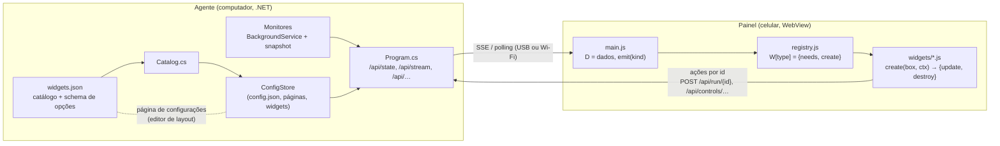
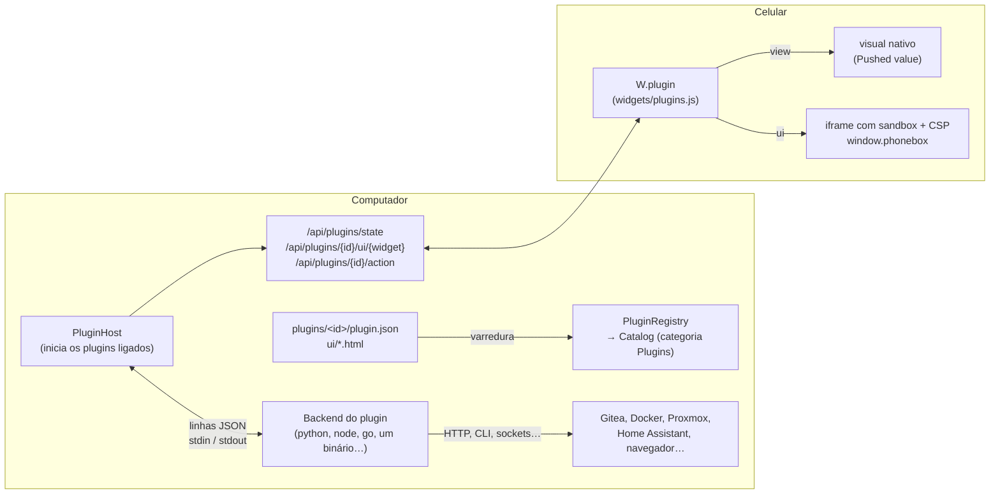

# Plugins da comunidade

*English: [PLUGINS.md](PLUGINS.md)*

Plugins adicionam widgets e integrações ao PhoneBox sem fork nem recompilação do agente: um monitor de Gitea ou
Proxmox, painéis do Home Assistant, controle de containers, uma ponte para uma extensão de navegador. Um plugin é uma
pasta com um manifesto (`plugin.json`), um **backend** opcional (qualquer programa que leia e escreva linhas JSON) e a
**UI** dos seus widgets.

Esta página explica como os widgets nativos funcionam, como os plugins se encaixam nesse desenho e como escrever um.
Exemplos funcionais estão em [`extras/plugins`](../extras/plugins): [`open-link`](../extras/plugins/open-link) é o menor
(uma configuração, um widget-link no celular e uma ação que abre um site no navegador do computador) e
[`http-status`](../extras/plugins/http-status) usa todas as partes (UI própria, visual nativo, notificações).

- [Como os widgets nativos funcionam](#como-os-widgets-nativos-funcionam)
- [Onde os plugins se encaixam](#onde-os-plugins-se-encaixam)
- [Instalando e gerenciando plugins](#instalando-e-gerenciando-plugins)
- [Escrevendo um plugin](#escrevendo-um-plugin)
- [Referência do manifesto](#referência-do-manifesto)
- [Protocolo do backend](#protocolo-do-backend)
- [UI do widget](#ui-do-widget)
- [Modelo de segurança](#modelo-de-segurança)
- [Limites](#limites)
- [Próximos passos](#próximos-passos)

## Como os widgets nativos funcionam

Um widget nativo fica espalhado em quatro lugares de dois programas: o **agente** no computador (.NET) e o **painel**
no celular (HTML/JS dentro de um WebView Android).



1. **Catálogo** (`agent/PhoneBox.Agent/widgets.json`): cada tipo de widget tem nome, ícone, categoria, tamanho e um
   schema de `options` (`text`, `number`, `bool`, `select`, `lines`, …). A página de configurações monta a lista de
   widgets e o inspetor de opções a partir dele (`GET /api/catalog`). O `Catalog.cs` o lê, e o `ConfigStore` descarta
   qualquer widget cujo tipo não esteja nele ao carregar ou salvar as configurações.
2. **Dados no computador**: um *monitor* (`DockerMonitor`, `GitHubMonitor`, `SystemMonitor`…) é um `BackgroundService`
   registrado com `AddMonitor<T>()` no `Program.cs`. Ele consulta algo num timer (muitas vezes só enquanto um celular
   está olhando) e guarda o último resultado num snapshot `volatile` que a API HTTP devolve.
3. **Transporte**: o celular mantém um stream de server-sent events (`GET /api/stream`) com `state` a cada segundo,
   `event` assim que algo acontece e `work` quando muda; sem ele, o painel faz polling em `/api/state`. Dados mais
   pesados têm endpoint próprio (`/api/docker`, `/api/calendar`, …), recarregado quando um número de versão em `state`
   muda ou num timer. Por USB isso passa pelo `adb reverse`; por Wi-Fi, por HTTPS com certificado fixado e token.
4. **Painel**: os widgets se registram num registro compartilhado, `W[type] = { needs, bare?, create(box, ctx) }`.
   `create` monta o DOM em `box` e devolve `{ update(kind), destroy() }`. `needs` lista os tipos de dado que disparam
   `update` (`state`, `push`, `work`, `tick`, …). O `main.js` guarda todos os dados no objeto global `D` e chama
   `emit(kind)`, que atualiza os widgets das páginas visíveis e marca os demais como pendentes.
5. **Ações** nunca carregam comandos: o celular envia um **id** (`POST /api/run/{atalho}`,
   `/api/widget/{página}/{widget}`, `/api/controls/command/{tipo}`), e o agente procura o que fazer na própria
   configuração. Ações perigosas exigem ainda uma opção explícita no widget (`control`, `allowKill`).

Ou seja, adicionar um widget ao próprio PhoneBox significa editar o `widgets.json`, escrever um monitor e uma rota em
C#, escrever um `W[type]` em `widgets/*.js`, importá-lo no `main.js` e publicar um novo agente e um novo APK.

Já existiam duas saídas genéricas, e os plugins se apoiam nas duas:

- **Webhooks** (`POST /api/push/{chave}`, `PushStore`): qualquer coisa pode enviar um valor; o widget *Pushed value* o
  mostra. Só num sentido, sem opções por widget, sem ações.
- Widget **Custom HTML** (`widgets/pc.js`): seu HTML/JS num iframe com sandbox que recebe os dados do painel por
  `postMessage`. Sem backend, e as únicas ações são atalhos existentes.

## Onde os plugins se encaixam



| Peça nativa | Equivalente no plugin |
|---|---|
| Entrada no `widgets.json` | `widgets[]` no `plugin.json`, mesmo schema de opções; aparece em **Plugins** na lista de widgets |
| Monitor (`BackgroundService` + snapshot) | O **backend** do plugin: um processo separado que o agente inicia, reinicia e encerra |
| Endpoint de dados + versão em `/api/state` | O backend envia `{"type":"state","key":…,"data":…}`; o painel recarrega `/api/plugins/state` quando `pluginsVersion` muda |
| `W[type]` em `widgets/*.js` | `"view"` (visual nativo, nenhum código no celular) ou `"ui"` (o HTML do plugin num iframe com sandbox) |
| Ações por id | `"actions": ["check", …]` no widget; o celular envia id da página + id do widget + nome da ação, o agente confere os três e repassa ao backend |
| Segredos na config, removidos pelo `ToPublic` | Configurações e opções com `"secret": true` nunca chegam ao celular |

O tipo de um widget de plugin é `plugin.<id do plugin>.<id do widget>`. As páginas mantêm esses widgets mesmo com o
plugin ausente ou desligado (o painel mostra um aviso no lugar), então remover um plugin nunca destrói um layout.

### Nada de um plugin é compilado no app

O app do celular só contém o host genérico (`widgets/plugins.js`). Tudo o que um widget de plugin precisa chega pela
conexão: os metadados do plugin junto com a config (`/api/config`), o HTML de cada widget
(`/api/plugins/{id}/ui/{widget}`) e os dados (`/api/plugins/state`). O painel guarda uma cópia local no armazenamento do
WebView, para que os widgets de plugin apareçam na hora depois de reiniciar e continuem mostrando os últimos dados
enquanto o computador está fora:

| O quê | Guardado como | Substituído / removido |
|---|---|---|
| Metadados (nome, versão, widgets, ações) | junto com a config (`cfg`) | a cada nova config |
| HTML do widget | `pb-plugin-ui:<plugin>@<versão>/<widget>` | quando o computador envia uma cópia diferente; versões antigas e plugins que não estão mais ligados são removidos |
| Últimos dados | `pluginState` | a cada mudança |

Por isso instalar, atualizar ou remover um plugin nunca exige um app novo.

## Instalando e gerenciando plugins

Tudo acontece em **Settings › Plugins** no computador:

- **Add plugin…** recebe um `.zip` com o `plugin.json` na raiz ou dentro da sua única pasta. O plugin entra
  **desligado**; nada dele roda ainda.
- Clique num plugin para abrir o menu dele:
  - **Configure** (a primeira opção) abre um painel com as configurações do plugin (URLs de API, tokens…). *Save*
    grava.
  - **Turn on / Turn off** (ligar/desligar): ao ligar, aparece o comando exato que vai rodar e as permissões, com pedido
    de confirmação.
  - **Restart** reinicia o backend.
  - **Update from a .zip…** substitui os arquivos do plugin e mantém as configurações.
  - **Uninstall** (desinstalar) encerra o plugin e apaga a pasta, as configurações e a pasta de dados dele. Os widgets
    continuam nas páginas como aviso.
- **Rescan** encontra pastas de plugin copiadas manualmente.

Os plugins ficam na pasta `plugins`, ao lado do `config.json`:

| Sistema | Pasta |
|---|---|
| Windows | `%APPDATA%\PhoneBox\plugins` |
| Linux | `~/.config/PhoneBox/plugins` |
| macOS | `~/Library/Application Support/PhoneBox/plugins` |

`--plugins <pasta>` usa outra pasta (útil durante o desenvolvimento, junto com `--config` e `--port`).

## Escrevendo um plugin

Um plugin mínimo com backend em Node.js e um widget com o visual nativo:

```
plugins/
  uptime-node/
    plugin.json
    main.js
```

`plugin.json`:

```json
{
  "id": "uptime-node",
  "name": "Uptime",
  "version": "0.1.0",
  "apiVersion": 1,
  "backend": { "command": "node", "args": ["main.js"] },
  "widgets": [
    { "id": "uptime", "name": "Uptime", "icon": "⏱️", "w": 3, "h": 2,
      "view": { "style": "big", "key": "uptime" } }
  ]
}
```

`main.js`:

```js
const os = require('os');
const readline = require('readline');
const send = (msg) => process.stdout.write(JSON.stringify(msg) + '\n');

function publish() {
  const h = Math.floor(os.uptime() / 3600);
  send({ type: 'state', key: 'uptime', data: { title: 'Uptime', value: h, unit: 'h', sub: os.hostname() } });
}

readline.createInterface({ input: process.stdin }).on('line', (line) => {
  const msg = JSON.parse(line);
  if (msg.type === 'init') { publish(); setInterval(publish, 60_000); }
  if (msg.type === 'shutdown') process.exit(0);
});
```

Copie a pasta para a pasta de plugins, clique em **Rescan**, ligue o plugin e adicione o widget *Uptime* (categoria
*Plugins*) a uma página.

Dicas:

- **Teste o backend à mão** primeiro: mande uma linha `init` pelo stdin e veja o que ele imprime
  (veja o [README](../extras/plugins/http-status/README.md) do exemplo).
- Escreva logs com `{"type":"log",…}` ou no **stderr**; os dois vão para o log do agente (`agent.log`). Nunca imprima
  outra coisa no stdout, nem deixe que programas iniciados pelo plugin escrevam nele: eles o herdam (veja como o
  [`open-link/main.py`](../extras/plugins/open-link/main.py) guarda uma cópia própria do stdout para o protocolo).
- Faça flush do stdout a cada linha (Python: `flush=True`; o agente também define `PYTHONUNBUFFERED=1`).
- Publique os dados de cada instância de widget na chave `"<página>.<widget>"` (de `instances[]`), e dados
  compartilhados em qualquer outra chave.
- Use a pasta de dados em `PHONEBOX_DATA_DIR` para cache e estado, não a pasta do plugin (uma atualização a substitui).
- Para desenvolver, rode um segundo agente: `PhoneBoxAgent --config ./dev/config.json --port 8799 --plugins ./plugins`
  e abra `http://127.0.0.1:8799/`.

## Referência do manifesto

`plugin.json` (comentários e vírgulas finais são permitidos):

| Campo | | |
|---|---|---|
| `id` | obrigatório | 2–40 caracteres: `a-z`, `0-9`, `-`. Único; faz parte dos tipos de widget e das URLs. |
| `name`, `version` | obrigatórios | Exibidos nas configurações (no máximo 60 / 32 caracteres). |
| `apiVersion` | obrigatório | `1`. |
| `author`, `description`, `homepage` | opcionais | `homepage` precisa ser `https://`. |
| `backend` | opcional | `{ "command", "args", "windows"?, "linux"?, "macos"? }`; as entradas por SO substituem `command`/`args` naquele sistema. `command` é um programa no `PATH` (`python3`, `node`) ou um caminho **relativo** dentro da pasta do plugin (`./bin/gitea-plugin`). Plugins sem backend só podem ter widgets `ui`. |
| `permissions` | opcional | `notify`: o backend pode mostrar notificações no celular. `network`: as UIs dos widgets podem carregar recursos `https://` e chamar APIs `https://` a partir do celular. |
| `settings` | opcional | Configurações do plugin, mesmo schema das opções de widget (`key`, `label`, `type`, `default`, `min`, `max`, `choices`), mais `"secret": true` para tokens (campo de senha, nunca vai ao celular). Tipos: `text`, `textarea`, `number`, `bool`, `select`, `lines`, `color`. |
| `widgets[]` | | Até 32 widgets: |
| `widgets[].id` | obrigatório | 1–40 caracteres: `a-z`, `0-9`, `-`. |
| `widgets[].name`, `icon`, `desc` | | Exibidos na lista de widgets. |
| `widgets[].w`, `h`, `minW`, `minH` | | Tamanho padrão e mínimo na grade 12 × 6. |
| `widgets[].options` | opcional | Opções por widget no editor de layout; `"secret": true` mantém uma longe do celular. |
| `widgets[].actions` | opcional | Nomes das ações que o widget pode enviar (`a-z0-9_.-`). Qualquer outra é recusada. |
| `widgets[].view` | um dos dois | `{ "style": "auto" \| "big" \| "gauge" \| "list", "key": "<chave de estado>", "unit"?, "min"?, "max"? }`: mostra essa chave de estado como um widget *Pushed value* (`value`, `title`, `sub`, `unit`, `items`, `level`, `progress`…). |
| `widgets[].ui` | um dos dois | Caminho relativo para um arquivo `.html` (≤ 256 KB) exibido num iframe com sandbox. |

## Protocolo do backend

O agente inicia o backend com a pasta do plugin como diretório de trabalho e conversa com ele com **um objeto JSON por
linha** no stdin/stdout (UTF-8). Toda mensagem tem um `"type"`.

Ambiente: `PHONEBOX_PLUGIN_ID`, `PHONEBOX_PLUGIN_DIR`, `PHONEBOX_DATA_DIR` (pasta onde o plugin pode gravar),
`PHONEBOX_API_VERSION`.

**Agente → plugin**

| Tipo | Campos | Quando |
|---|---|---|
| `init` | `apiVersion`, `agentVersion`, `os`, `plugin {id, version}`, `settings {…}`, `instances [...]` | Primeira linha após iniciar. |
| `config` | `settings`, `instances` | As configurações ou os widgets do plugin nas páginas mudaram. |
| `action` | `id`, `instance`, `page`, `widget`, `name`, `args` | Um widget no celular pediu uma das ações declaradas. Responda com um `result` em até 15 s. |
| `shutdown` | | Encerre agora; o processo (e os filhos) é morto após 3 s. |

`instances` lista cada widget do plugin colocado numa página:
`{ "instance": "home/eps", "page": "home", "id": "eps", "widget": "endpoints", "pageEnabled": true, "options": {…} }`
(opções já com os padrões do manifesto preenchidos).

**Plugin → agente**

| Tipo | Campos | Efeito |
|---|---|---|
| `state` | `key`, `data` | Publica dados para os widgets (`data: null` remove a chave). Chaves: `A-Za-z0-9_.-`, no máximo 64. |
| `result` | `id`, `ok`, `error?`, `data?` | Resposta a uma `action`; `data` volta para a UI do widget. |
| `notify` | `title?`, `text?`, `level?` (`info`/`ok`/`warn`/`error`), `seconds?`, `vibrate?` | Notificação no celular. Precisa da permissão `notify`; no máximo 6 por minuto. |
| `log` | `level?` (`debug`/`info`/`warn`/`error`), `message` | Vai para o log do agente. |

Ciclo de vida: só os plugins ligados rodam. Um backend que termina é reiniciado após 1 s, depois 2, 4 … até 60 s
(zerado depois de um minuto rodando). Desligar, desinstalar ou atualizar um plugin envia `shutdown` e depois mata a
árvore de processos. No Windows os backends ficam presos ao agente por um Job Object, então nunca sobrevivem a ele.

## UI do widget

### `view`: nenhum código no celular

O widget mostra uma chave de estado com os estilos do widget *Pushed value*. Publique um objeto como
`{"title":"Build","value":"passed","sub":"main · 3m","level":"ok"}`, um número ou uma lista
(`{"items":[{"label":"web","value":"up","level":"ok"}]}`).

### `ui`: seu próprio HTML

O arquivo é carregado num `<iframe sandbox="allow-scripts">` com esta Content-Security-Policy:

```
default-src 'none'; script-src 'unsafe-inline'; style-src 'unsafe-inline'; img-src data:; font-src data:; media-src data:
```

Com a permissão `network`, `img-src` e `connect-src` também aceitam `https:`. Coloque scripts e estilos inline. A página
recebe um objeto `window.phonebox`:

| | |
|---|---|
| `phonebox.on('instance', fn)` | Os dados deste widget (a chave `"<página>.<widget>"`), agora e a cada mudança. |
| `phonebox.on('state', fn)` | Todas as chaves de estado do plugin, como `{ chave: dados }`. |
| `phonebox.options` | As opções deste widget no editor de layout (sem as secretas). |
| `phonebox.instance` | `{ page, id, key }`. |
| `phonebox.action(nome, args?)` | Envia uma ação declarada; resolve com o `result.data` do backend, rejeita com o `error`. `args` precisa ser JSON, ≤ 4 KB. |
| `phonebox.goto(página)` | Troca o painel para uma página (id ou número a partir de 1). |
| `phonebox.toast(texto, tipo?)` | Uma mensagem curta no painel (`tipo`: `ok` ou `err`). |

As variáveis CSS seguem o tema do painel: `--pb-text`, `--pb-dim`, `--pb-accent`, `--pb-card`. O body é transparente,
então o visual do card (Settings › Appearance) aparece por trás.

## Modelo de segurança

- **Opt-in**: descobrir um plugin só lê o manifesto. Nada roda até o usuário ligá-lo, depois de um diálogo que mostra o
  comando e as permissões. Arquivos de páginas importados com widgets de plugin pedem confirmação antes de manter as
  opções deles.
- **Ids, não comandos**: o celular envia id da página, id do widget e nome da ação. O agente confere se o plugin está
  ligado, se o widget existe naquela página, tem aquele tipo e declara aquela ação (`PluginHost.ActAsync`); o painel
  confere a lista de ações também. Os argumentos ficam limitados a 4 KB de JSON.
- **Segredos ficam no computador**: as configurações dos plugins nunca vão para o celular, e opções marcadas `secret`
  são removidas da config enviada ao celular (`StackWidgets.PublicOptions`).
- **UI em sandbox**: sem `allow-same-origin`, o frame tem origem opaca: não acessa o painel, o armazenamento dele, o
  agente (cujo proxy exige um cabeçalho que um frame em sandbox não consegue enviar entre origens) nem a ponte Android.
  Só são aceitas mensagens daquele frame, e ele só recebe os dados e as opções **do próprio plugin** (nunca as secretas).
- **O que a CSP faz e o que não faz**: sem a permissão `network`, a CSP bloqueia `fetch`, XHR, imagens, fontes e mídia da
  rede, então uma UI não carrega conteúdo remoto nem chama APIs. Ela não impede o frame de navegar para outra página
  (`location = …`, `<meta http-equiv="refresh">`), e uma navegação pode levar dados na URL. O painel detecta isso (toda
  página que ele carrega precisa se apresentar primeiro) e para o widget, mas a requisição já terá sido feita. Portanto a
  permissão `network` controla o que uma UI pode carregar; ela **não é uma fronteira de confidencialidade**. Isso é
  aceitável porque a UI só vê dados que o próprio backend do plugin já tem, e esse backend tem acesso à rede de qualquer
  forma: confie na UI de um plugin exatamente tanto quanto no backend dele.
- **Exposição na rede**: pelo Wi-Fi só `/api/plugins/state`, `/api/plugins/{id}/ui/{widget}` e
  `/api/plugins/{id}/action` são acessíveis (com o token do pareamento). Listar, instalar, desinstalar e reiniciar são só
  locais, como o resto das configurações.
- **Entradas limitadas**: manifestos, arquivos de UI, linhas, valores de estado, chaves, notificações e arquivos `.zip`
  têm limite de tamanho; caminhos em manifestos e arquivos compactados não podem sair da pasta do plugin.
- **O que um plugin pode fazer**: o backend roda **com os direitos do seu usuário**, como qualquer programa instalado.
  As verificações acima protegem o celular, o painel e a API do agente contra um plugin e contra a rede; elas não isolam
  o backend em si. Ligue apenas plugins em que você confia, de preferência com código-fonte que você possa ler.

## Limites

| | |
|---|---|
| Plugins | 100 pastas |
| `plugin.json` | 256 KB |
| Widgets por plugin | 32; 32 ações e 40 opções cada |
| Arquivo de UI | 256 KB |
| Linha vinda do backend | 128 KB |
| Estado | 64 chaves por plugin, 64 KB por chave |
| Ação | args ≤ 4 KB; resposta em até 15 s |
| Notificações | 6 por minuto por plugin |
| `.zip` | 20 MB, 64 MB descompactado, 2000 arquivos |

## Próximos passos

Esta primeira versão cobre o caso mais comum. Ideias para depois, mais ou menos em ordem:

1. **Widgets de plugin no Smart Stack**: hoje eles ficam fora das pilhas (os ids dos filhos de uma pilha não são
   widgets de página, então as ações não podem ser conferidas do mesmo jeito).
2. **Permissão de rede por host** (`"network": ["https://gitea.example.com"]`) em vez de todo `https:`.
3. **Mais tipos de configuração** para plugins (segredo por instância de widget, seletor de arquivo, botões de teste
   que chamam uma ação do backend a partir das configurações).
4. **Ponte para extensões de navegador**: um pequeno host de native messaging distribuído com o PhoneBox, para que uma
   extensão (por exemplo do Google Meet: mudo, câmera, sair) converse com um plugin sem abrir uma porta local.
5. **Backends HTTP/WebSocket de longa duração** como alternativa ao stdio, para plugins que já rodam como serviço.
6. **Plugins .NET** carregados no próprio processo (`AssemblyLoadContext`, uma interface `IPhoneBoxPlugin` num pacote
   pequeno de contratos). Mais rápidos e tipados, mas rodariam dentro do agente sem fronteira de processo e teriam de
   acompanhar a versão do .NET do agente; o protocolo stdio mantém os plugins independentes de linguagem e isolados, por
   isso continua sendo o padrão.
7. **Um índice de plugins** (uma lista JSON num repositório) com checksums e assinaturas, para encontrar e atualizar
   plugins em Settings › Plugins.

### Checklist de publicação

- [ ] O `plugin.json` é válido (o agente mostra o motivo quando não é) e `apiVersion` é `1`.
- [ ] O backend imprime no stdout apenas linhas do protocolo e responde toda `action` com um `result`.
- [ ] Tokens são `settings` (ou opções) com `"secret": true`, nunca fixos no código.
- [ ] Pede apenas as permissões de que precisa.
- [ ] Um README diz o que ele faz, o que precisa estar instalado (Python, Node…) e como configurá-lo.
- [ ] Publicado como `.zip` com a pasta do plugin (ou o `plugin.json`) na raiz.
